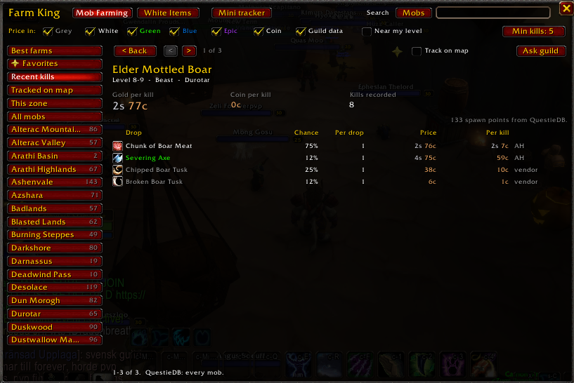

# Farm (was Farm King)



Which mobs are worth farming. Part of **King Maker**: Farm ranks mobs by the
**average gold a kill is worth**: the coin they drop plus each drop's chance
times what it sells for, priced by King Maker's **Scanner** (Scanner King).

## Where things are

| What | Where |
|---|---|
| The mob list and a mob's page | King Maker window, **Farming > Mob Farming** (`/fk`, `/km mobs`) |
| White Items | **Farming > White Items** (`/fk white`) |
| The farm tracker | A small floating box: the crown's **Farm tracker** quick action, the button on Mob Farming, or `/fk mini` |
| Mobs in your zone | Right-click the King Maker crown: **This zone's mobs** |
| Settings | **Settings > Farm**: guild sharing, Min kills, near my level, the farm tracker |
| Home | A **Farm session** tile while the farm tracker has something in it |

Farm has no minimap button of its own any more: the King Maker crown does its
clicks. Its saved data (`FarmKingDB`) keeps the 1.x shape, and a 1.x
`Farm_King` folder's data moves in on first login.

## Better with

- **[QuestieDB](https://github.com/Questie/QuestieDB/releases)** adds every mob in the game, with levels, zones, spawn points and what they drop, plus **Track on map**. Without it Farm only knows the mobs you've seen yourself. Download **QuestieDB-Forever.zip** from the latest release (not "Source code") and extract it into `Interface\AddOns\`.
- **Mail** (Mail King) files the items your mobs drop under its Mob drops strategy.
- Guildmates running King Maker (or Farm King) share their drop data when you **Ask guild**.

## Where the numbers come from

Nobody publishes drop rates for Forever (Blizzard keeps loot tables on the
server), so Farm King records them as you play:

- **Mobs you see**: target, mouse over or see a nameplate, and Farm King notes
  its name, level, elite or rare, type, and where you were.
- **Kills**: every item and coin in a loot window is credited to the exact
  corpse it came from, so looting several corpses at once still adds up right.
  A corpse counts once (remembered for an hour, through `/reload`); opening it
  again changes nothing. Skinning, herb gathering, mining, fishing and
  pickpocketing are ignored, even on corpses someone else killed.
- **Kills with no loot** count too when you're solo, so a mob that often drops
  nothing isn't made to look better than it is. Mobs someone else tagged
  don't count. If a corpse counted as empty turns out to have loot, the loot
  is added without counting the kill twice.
  Forever closes the combat log to addons, so Farm King spots a kill by
  seeing a mob you were fighting die as your target or on its nameplate.
  With enemy nameplates off, an empty corpse you never target is missed.
- **In a group** only corpses you open count, so a mob can look a little
  better than it is (empty corpses and what groupmates already took are
  missed), and two guildmates opening the same corpse both record it. Solo
  farming gives the truest numbers.
- **Your guild**: see below.

Drop chances are averages over many kills. The more kills behind a mob, the
better its numbers: under **Min kills** they show in grey.

## Prices

| Drop | Worth |
|---|---|
| Grey (junk) | Its vendor price |
| Bind on pickup | Its vendor price (it can't go on the auction house) |
| Anything else | The better of the auction house (Scanner King's market price, after the 5% cut) and a vendor |
| Quest items | Nothing |

## Mob Farming

Open it from the King Maker window (**Farming > Mob Farming**), the crown's
quick actions or `/fk`.

**Top.** Tick what to price in: Grey, White, Green, Blue, Epic drops and Coin.
**Guild data** adds your guildmates' kills to yours. **Min kills** is how many
kills a mob needs before it's ranked under Best farms (click to cycle 1, 5, 10,
25, 50). Under that: the search box, **Near my level** (mobs from 5 levels
under you to 3 over) and **Farm tracker**.

**Left side.** Best farms, Favorites, Recent kills (the last 25 mobs you
killed, the latest first), Tracked on map, This zone, All mobs, then
every zone. Scroll it with the mouse wheel.

**The list.** Mob, level, zone, **gold per kill**, coin per kill, kills and
best drop. Click a column to sort by it. Right-click a mob to make it a
favorite (a star shows next to it). **Ask guild** sits bottom right.

**Hunting an item.** Click **Mobs** next to the search box to switch it to
**Items**, then type part of an item's name (or shift-click an item link into
the box). Pick an item and the list shows every mob known to drop it: from
your kills, your guild's and QuestieDB's drop lists. Highest level first, with
level range, zone, spawn points, drop chance and the kills behind it, and gold
per kill. The bottom line sums it up: how many mobs, their levels and spawn
points. Price History's **Hunt in Farm King** button opens this list for the
item you're looking at.

**A mob's page.** Click any mob; its page takes the list's place:
- Gold per kill, coin per kill and kills recorded (yours and your guild's).
- Its loot table: each drop's chance, how many come at once, its price, what it
  adds per kill, and whether that price is the auction house or a vendor.
  Drops left out by your filters are dimmed. Drops QuestieDB lists that nobody
  has seen yet are at the bottom as "not seen".
- **Favorite**, **Track on map** (its spawn points on your world map as small
  gold dots: QuestieDB's spawn points, or the spots you've seen it; hover a
  dot for its name and value) and **Ask guild**.
- **< Back** returns to the list; the arrows step through it.

## White Items

The **White Items** page (Farming > White Items, or `/fk white`) helps you find
white items worth hunting. It lists every white item that the Scanner has an
auction price for and that some mob is known to drop, with:

- **Price**: what one sells for at the auction house, after the 5% cut,
- **Listed**: how many are up for sale (lots listed means competition),
- **Mobs** and **Spawns**: how many mobs drop it and their spawn points
  together (QuestieDB's, or the spots you've seen them),
- **Best chance**: the best drop chance from your and your guild's kills,
- **Score**: price times the square root of spawn points, with the best item
  at 100. Plenty of mobs to farm counts, but a cheap drop can't win on numbers
  alone.

Click a column to sort by it. Click an item for every mob that drops it
(highest level first, on Mob Farming), and a mob for its page. A Deep Scan
prices every item, so run one first.

## Farm tracker

The crown's **Farm tracker** quick action, the **Farm tracker** button on Mob
Farming, or `/fk mini` shows a small movable box that tallies what you're
farming:

- every mob you've killed, how many, and what their kills brought in,
- every drop, how many, and what they're worth, plus the coin you looted,
- the total.

**Start timer** adds gold per hour for what you farm while it runs; without it
you just see totals. Pause and resume it as you like (a `/reload` pauses it and
keeps its time). **Reset** clears the box, `-` folds it to its title bar (which
still shows your total or gold per hour), `x` closes it. It remembers where you
dragged it.

## Your guild

Drop data is shared on request, so it costs nothing until someone asks:

- **Ask guild** (bottom right of the list, and on every mob page) asks
  guildmates running King Maker or Farm King for their data on those mobs.
- Everyone who has killed them answers with their own totals. Each
  guildmate's latest answer replaces their last one, so asking again never
  counts the same kills twice. Only your own kills are ever sent, and only
  guild chat is listened to.
- With **Guild data** ticked their kills add to yours; untick it to see only
  your own. `/fk share off` (or Settings > Farm) stops you answering,
  `/fk forget guild` drops everything guildmates sent.

| Command | What it does |
|---|---|
| `/fk` | Open or close Mob Farming |
| `/fk white` | Open White Items |
| `/fk mob <npcID>` | Open a mob's page |
| `/fk status` | What's been recorded, and whether QuestieDB was found |
| `/fk share on` / `off` | Answer guildmates' requests for your drop data |
| `/fk forget guild` | Drop every guildmate's data |
| `/fk mini on` / `off` | The farm tracker |
| `/fk button` | Says where the button went: the King Maker crown (`/km button`) |

## For addon authors

```lua
FarmKing.ShowItem(itemID)     -- open Mob Farming on every mob that drops the item
FarmKing.GoldPerKill(npcID)   -- gold per kill with the current filters, and the kills behind it
FarmKing.IsDrop(itemID)       -- true when mobs drop it (your loot, your guild's, or QuestieDB); Mail King uses it
```

## Tests

`python tests/run.py farm` (from `AddOns/King_Maker`) runs Farm with the
Scanner against the shared stand-in for the game and a stand-in QuestieDB
(`tests/farm.py`; needs `pip install lupa`).

## Credits

Mob, spawn and drop-list data comes from QuestieDB at runtime (it's read from
your installed copy, not copied into this addon).
