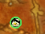

# Gathering (was Gather King)



Gathering spots on your map, inside King Maker. Type `/gt mine thorium` while standing at a node and a Thorium icon appears at that spot on your world map and minimap; harvest a node and it's marked for you. It works with Leatrix Maps, since Leatrix draws on top of the normal world map, and the coordinates match the ones Leatrix shows.

Since King Maker 2.0 it has no minimap button or settings panel of its own: its options are the **Farming > Gathering** page of the King Maker window, and the King Maker crown does its clicks. Your Gather King 1.x markers and profiles move in by themselves (`GatherKingDB` keeps its shape). Since King Maker 2.6 the farming ledger box is King Maker's **Farm Tracker** (see below).

## Where things are

| What | Where |
|---|---|
| Every option: profiles, node types, display, only these names, delete markers, export and import | King Maker window, **Farming > Gathering** (`/gt settings`, `/km gathering`) |
| What you gather, its value and gold per hour | King Maker's **Farm Tracker**: the crown's **Farm Tracker** quick action, the Gathering page tick, `/farm` or `/gt ledger` |
| Switch profile | Right-click the King Maker crown: **Switch gathering profile** (a menu of your profiles) |
| The most-used toggles | King Maker **Settings > Gather** |

Prices come from King Maker's **Scanner** (Scanner King): worth per harvest on each marker, and gold in the Farm Tracker. Markers are shared with guildmates running King Maker or Gather King.

## Use

Stand at the node and type one of these:

| Command | What it does |
|---|---|
| `/gt mine thorium` | Marks a Thorium node here with the Thorium ore icon |
| `/gt herb peacebloom` | Marks a Peacebloom here with the Peacebloom icon |
| `/gt fish` | Marks a fishing spot here (name optional, e.g. `/gt fish oily blackmouth`) |
| `/gt treasure` | Marks a chest or other treasure |
| `/gt thorium` | Same as `/gt mine thorium`; the type is guessed from the name |
| `/gt delete nearby` | Deletes the marker closest to you |
| `/gt undo` | Undoes your last add or delete |
| `/gt list` | Lists the markers in your current zone |
| `/gt scan` | Scans auction house prices (the auction house must be open) |
| `/gt settings` | Opens the Gathering page |
| `/gt hide fish` / `/gt show fish` | Hides or shows one type (`all` works too) |
| `/gt auto on` / `/gt auto off` | Automatically tags mining and herb nodes when you harvest them (on by default) |
| `/gt sync on` / `/gt sync off` | Shares markers with guildmates running King Maker or Gather King (on by default) |
| `/gt only thorium, mithril` | Only shows markers with these names (`/gt only all` shows everything again) |
| `/gt profile` | Lists your profiles. `/gt profile <name>` switches, `/gt profile new <name>` creates, `/gt profile delete <name>` deletes |
| `/gt minimap on` / `/gt minimap off` | Shows or hides markers on the minimap |
| `/gt opacity 50` | How solid minimap markers are, 10 to 100%. (default 100%) |
| `/gt size 20` | Changes marker size on the world map (8 to 32) |
| `/gt ledger` | Shows or hides the Farm Tracker (`on`, `off`; `reset` saves the session to the Farming Ledger, `timer` pauses or resumes it) |
| `/gt sync now` | Checks your markers against guildmates online right now and swaps what's missing |
| `/gt button` | Says where the button went: the King Maker crown (`/km button`) |
| `/gt help` | Lists every command |

Parentheses are fine too: `/gt mine (thorium)` works the same.

Hover a marker to see its name and coordinates.

### Deleting markers

- **Right-click** a marker on the map and pick *Delete this node*.
- **Shift + right-click** deletes a marker straight away.
- `/gt delete nearby` deletes the marker closest to you.
- To delete in bulk (every marker of a type in this zone, or everywhere), use the Gathering page. Each bulk delete asks you to confirm first.
- Every delete can be undone with `/gt undo`, until you `/reload` or log out.

### Small, Rich and Heavy Thorium

Small and Rich Thorium Veins both give Thorium Ore, so Gathering reads the vein's own name as you start mining it and keeps them apart:

| Marker | Ring | Hover says |
|---|---|---|
| Small Thorium | gold ring, Thorium Ore icon | Small Thorium Vein: Mining 230 |
| Rich Thorium | orange ring, Arcane Crystal icon | Rich Thorium Vein: Mining 255, more ore per harvest |
| Heavy Thorium | blue ring, Fel Crystal icon | Heavy Thorium Vein: new in WoW Forever, drops Fel Crystal |
| Thorium | gold ring, Thorium Ore icon | Small or Rich: mine it once to find out which |

Markers from before 2.5.1 just say Thorium; the next time you mine one it learns which vein it is (even with auto-tagging off) and tells your guild. A plain "Thorium" from an older guildmate never replaces a Small or Rich name. A spot that has spawned both shows "Also spawns here" when you hover it. `/gt only thorium` still shows all three; `/gt only rich thorium` shows just the Rich ones.

### Recently harvested nodes

When you harvest a mining or herb node, its marker turns gray and faded for 5 minutes so you can tell at a glance which spots you just cleared. Hovering it shows how long ago you harvested it. Change the time (or turn it off) on the Gathering page. This works even with auto-tagging off, as long as the spot already has a marker.

While you're standing right at a marker, its minimap ring hides so you can see the node itself. Untick *Hide a minimap marker while I'm standing at it* to keep it.

### Loot stats

Every time you harvest a marked node, the addon records what it gave you. Hover the marker to see it:

```
Harvested 24 times (you: 9, guild: 15)
  Thorium Ore      100%  avg 2.3
  Dense Stone       63%  avg 1.4
  Pyrite             8%  (2 of 24)
```

The % is how often each item dropped at that spot, and avg is how many you got when it did. With guild sync on, guildmates' harvests of the same spot are added in, so the numbers come from everyone. Each person's counts are kept separately and replaced when they send an update, so nothing is counted twice.

### Auction prices

Price scanning is King Maker's **Scanner** module. Open the auction house and click **Material Scan** (top right), or type `/gt scan` (same as `/sk scan`). The Scanner scans every Trade Goods item, plus anything Gathering asks for that isn't Trade Goods, like Forever's herb seeds, and shares prices with your guild.

Hovering a marker shows each item's price next to its drop rate, plus "Worth about X per harvest" based on the node's loot stats, and how old the prices are.

Prices you scanned with Gather King 1.x move into the Scanner automatically.

### Farm Tracker (was the farming ledger)

Since King Maker 2.6 the farming ledger box is the **Farm Tracker**, one box for
gathering and mob farming alike (its own README: `Modules/Tracker/README.md`):

- It tallies mining, herbs, fishing, treasure and containers (and mobs, skinning
  and pickpocketing) with their value and gold per hour. Every session is saved
  to the **Farming Ledger** page (**Farming > Farming Ledger**), so **Reset**
  became **Stop & save**: nothing is lost.
- A session starts by itself after a few nodes or catches; the clock pauses when
  you stop gathering and takes the idle minutes back off.
- `/gt ledger` still shows and hides it (`on`, `off`); `/gt ledger reset` saves
  the session and starts fresh; `/gt ledger timer` pauses or resumes it. `/farm`
  does the same and more.
- The **Mat Prices** tab is the tracker's **Prices** tab, unchanged: **Mining**,
  **Herbs**, **Skins**, **Cloth** and **Ench**, most valuable first, scroll with
  the mouse wheel. Prices there use King Maker's one value rule now (the auction
  price after the 5% cut, or the vendor price if that's better), so they read a
  little lower than the old raw lowest buyout.
- Your old ledger moved into the Farming Ledger as one **Carried over** session,
  and the tracker shows where your ledger box was.

### The Gathering page

Open it from the King Maker window (**Farming > Gathering**), the crown or `/gt settings`. It holds every option in one place:

- **Summary** at the top: markers by type, zones, harvests recorded, and this zone.
- **Profile:** which profile you're using, a button per profile to switch, a box to name a *New profile* (it starts as a copy of the current one) and *Delete this profile*.
- **Node types:** for each type, whether it shows on the map and (for mining and herbs) whether it gets auto-tagged when you harvest it, plus the auto-tag master switch, guildmates' markers, guild sync and the Farm Tracker.
- **Display:** marker size, minimap markers on or off, minimap marker opacity, hiding the ring you're standing at, and how long harvested nodes stay faded.
- **Only show these names:** e.g. `thorium, mithril` to see just those nodes (press Enter).
- **Delete markers:** delete all of one type, or everything, in this zone or in every zone. Each asks you to confirm.
- **Share with friends:** export and import codes (see below).

The page scrolls with the mouse wheel.

### Profiles

A profile is a saved set of the options above: what you see on the map and what gets auto-tagged. For example, a "Thorium run" profile that only shows Thorium and only auto-tags mining, and a "Herbs" profile for herbing. New profiles start as a copy of the one you're using.

Your markers are shared by every profile, so switching profiles never loses or hides data for good. It only changes what's shown and recorded.

### Icons

Each marker uses the game's own icon for what that node gives you: a Thorium node shows the Thorium Ore icon, Mithril shows Mithril Ore, Peacebloom shows Peacebloom, and so on. Every classic ore and herb is covered (Copper through Thorium, Dark Iron and Obsidian, Peacebloom through Black Lotus), plus Forever's new Heavy Thorium, Marefoil, Demonsage and Death Lotus, and a few fishing pools. When auto-tagging a node the addon doesn't know, it names the marker after the main item you looted and uses that item's icon, so anything new Forever adds still gets a proper marker. Scarce materials (Pyrite, Frilled Lichen and friends), seeds and stones never name a node, since any node can drop them. On the world map the icon sits inside a colored ring for its profession: gold for mining, green for herbs, blue for fishing, purple for treasure. On the minimap a marker is just that colored ring with an empty middle, so when the node is up you see the game's own node dot inside it. A name the addon doesn't know (like `/gt fish my secret spot`) still gets saved and shown, using the plain Mining / Herb / Fishing icon.

### Action bar buttons

To get one-click buttons, make a macro (`/macro`) with the text `/gt mine` (or `/gt herb`, `/gt fish`) and drag it to your action bar.

## Guild sync

Everyone in your guild who runs King Maker (or Gather King 1.x) shares markers automatically. There's nothing to set up.

- A marker you add (by command or by harvesting) goes out to guildmates who are online right then.
- When you log in, and every 30 minutes after, King Maker checks your list against guildmates who are online. If they match, nothing is sent. If not, one guildmate answers and you swap only the zones that differ: you get their markers there and they get yours.
- New to the guild, or just installed King Maker? The first guildmate to answer sends you everything they have, so you start with the whole guild's map.
- Shared markers say "Shared by <name>" when you hover them. Untick *Show markers shared by guildmates* in a profile to hide them there.
- Deletes stay personal. A marker you delete won't come back from a guildmate's sync, and it isn't deleted for them.
- `/gt sync off` turns it off, and `/gt sync now` checks again right away.
- If you mark a node someone else already marked, you both end up with the same spot (the coordinates may shift by a hair), so your lists match.

Syncing only works with guildmates who are online at the same time, since the game has no place to store shared data. Everyone carries a full copy, though, so any one of them can catch you up. A big first sync takes a little while, about one message per second, because the game limits how fast addons can talk.

## Sharing with friends outside your guild

On the Gathering page under *Share with friends*, click **Export all** or **Export this zone**. A code appears in the box, already selected: press Ctrl+C and paste it in Discord or anywhere else. Your friend pastes it into the same box with Ctrl+V and clicks **Import**. Markers they already have are skipped.

## Where markers are saved

Markers are saved account-wide in `WTF\Account\<ACCOUNT>\SavedVariables\King_Maker.lua` (as `GatherKingDB`, the same shape as 1.x), so they survive updates. WoW writes this file when you log out or `/reload`.

## Notes

- Built for the Forever client (interface 16001). Forever uses the modern WoW addon API, so this won't load on Classic Era.
- Auto-marking listens for the Mining and Herb Gathering spells and reads the loot window to name the node. If Forever names those spells differently, auto-marking stays quiet and `/gt` still works.
- The bundled libraries (LibStub, CallbackHandler, HereBeDragons) now live in `King_Maker\Libs`, and the ring texture in `King_Maker\Textures`.

## Tests

`python tests/run.py gather` (from `AddOns/King_Maker`) runs Gathering with the Scanner, and on its own, against the shared stand-in for the game (`tests/gather.py`; needs `pip install lupa`).
