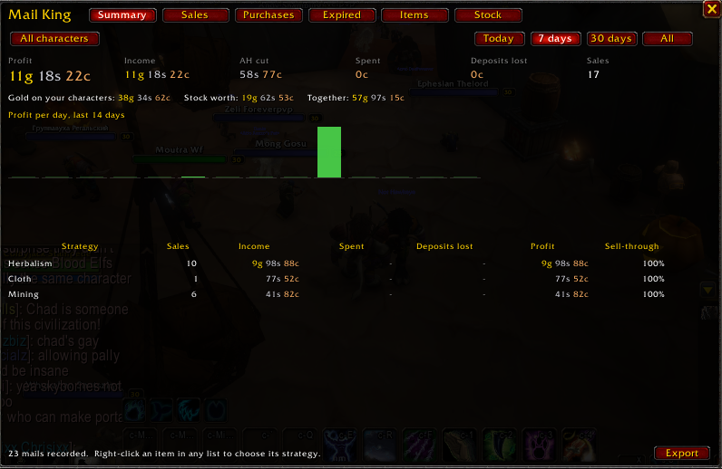

# Sales Ledger (was Mail King)



The money side of King Maker. Every auction house mail you open goes into a ledger, so you can see
what you actually made, where it came from, and which of your farms and strategies pay off.

- **Gathering** finds the nodes, **Mob Farming** finds the mobs, the **Scanner** prices it all.
- The **Sales Ledger** tells you what it turned into, who's buying it, and what isn't selling.
- **Inventory** tells you what you're still holding and your net worth.

Since King Maker 2.0 it has no window or minimap button of its own: it's the **Auction House > Sales
Ledger** page of the King Maker window. Your Mail King 1.x ledger, strategies and settings move in by
themselves.

## Where things are

| What | Where |
|---|---|
| The ledger | King Maker window, **Auction House > Sales Ledger** (`/mlk` or `/km ledger`) |
| Open it from the minimap | Right-click the King Maker crown: **Sales Ledger** |
| Profit at a glance | Hover the crown (last 7 days), or the **Profit, 7 days** tile on Home |
| Period, whose mail, export, clearing the ledger | King Maker **Settings > Sales Ledger** |
| Mail your alts in one click | **My characters**, beside the mailbox |

## What it records

Open your mailbox and every auction house mail in it is recorded, once:

| Mail | What's kept |
|---|---|
| Auction successful | Price, the auction house cut, the buyer, and when it sold |
| Auction won | What you paid and the seller |
| Auction expired / cancelled | The deposit you lost |

- **Opening the mailbox again changes nothing.** You don't have to take the gold out either: a mail
  is remembered and only ever counted once.
- **Sales are dated when they sold, not when you read the mail.** Auction mail lasts 30 days, so the
  time left on it gives the date.
- **Deposits and prices.** When you post an auction, the Sales Ledger notes its deposit and your
  price, so an expired auction shows what it cost you and what you were asking.
- **Buyers.** Every sale mail names the buyer, so the Sales Ledger knows who buys from you, how often
  and what.
- **Characters.** Each character's mail is kept separately. Look at all of them together, or just
  the one you're on.

## The page

Tabs along the top: **Summary**, **Sales**, **Purchases**, **Expired**, **Items**, **Not selling** and
**Buyers**, with **Export** on the right. Under them, whose mail you're looking at (**All
characters** or **This character**) and the period (**Today**, **7 days**, **30 days** or **All**).

- **Summary.** Profit, income, the auction house cut, what you spent, deposits lost and sales; your
  best buyer, and your net worth from Inventory (hover the line for your top five buyers, click it for
  the Buyers tab). Below that, profit per day for the last two weeks (green up, red down), and every
  strategy ranked by profit with its sell-through. Click a strategy to see its items.
- **Sales, Purchases, Expired.** Every one, newest first.
- **Items.** Every item you've traded: units sold, average price, income, spent, sell-through, and the
  Scanner's market price today, so you can see whether you're selling under the market.
- **Not selling.** Every item that came back expired or cancelled, worst first (most deposits
  lost): how many sold and came back, sell-through, deposits lost, what you asked against today's
  market price, when it last sold, and why it might be stuck:
  - **over market**: you asked 10% or more over today's market price (in red, with how much),
  - **never sold**: none sold in this period,
  - **slow**: under half of them sold.

  Hover an item for the numbers and a suggestion, and how many you still have.
- **Buyers.** Everyone who bought from you: how many of your auctions (one mail each), units, what
  they paid, their average sale, their share of your sales, how many different items and their
  favourite. Your regulars (3 or more sales) are in gold. Hover one for everything they've bought;
  click one for just their sales. The **Buyers** button switches to **Sellers**: the people you buy
  from. Hover a sale on the Sales tab to see how many times that buyer has bought from you.

Every list sorts by any column: click it, click again to flip it.

Stock (what you hold on every character) and your gold moved to **Inventory** in 1.2. It brings over
everything Mail King 1.1 knew.

**Profit = income (after the cut) − what you spent − deposits lost.**

## Strategies

Every item counts toward a strategy, which is how the ledger answers "which of my farms is working?"
An item gets one automatically, in this order:

1. **Your choice.** Right-click any item, in any list, to pick a strategy or make a new one, such as
   "Arathi wool farm" or "Strath runs".
2. **Flips.** You bought it on the auction house within 30 days before selling it. What you paid and
   what it sold for land on the same line, so its profit is your margin. Something you bought and
   haven't sold counts under **Purchases**.
3. **The kind of material.** Mining, Herbalism, Skinning, Cloth, Enchanting, Cooking, Elemental.
4. **Mob drops.** Mob Farming knows mobs drop it, from your loot, your guild's, or QuestieDB.
5. **Everything else.** Gear, Consumables, Recipes, Other.

Your choices apply to past sales too, so you can sort old history into strategies whenever you like.
Inventory's Items tab sorts what you hold into the same strategies.

## My characters

Open a mailbox and **My characters** sits to the right of it: your other characters that this one can
mail (same realm and faction), highest level first, in their class colours, with the gold each had
when you last logged out. Click one and its name goes in the **To:** box of Send Mail (from the
Inbox it switches to Send Mail for you), and the cursor moves to the subject. The one you're mailing
is highlighted. Scroll it if you have more than 16.

A character shows up once you've logged in to it with King Maker. Forever names have a
surname; a character last saved by King Maker 2.2 or older shows its first name only until you log in to
it again, or until you send it mail (or it sends you mail) with its full name, which the list remembers. Turn the list off in **Settings >
Sales Ledger** or with `/mlk alts`.

## Export

**Export** (or `/mlk export`) opens the whole ledger as comma-separated text. Press Ctrl+A, then
Ctrl+C, and paste it into a spreadsheet.

## Commands

| Command | |
|---|---|
| `/mlk` | Open or close the Sales Ledger |
| `/mlk status` | What's been recorded |
| `/mlk export` | The ledger as text for a spreadsheet |
| `/mlk alts [on\|off]` | My characters beside the mailbox |
| `/mlk reset yes` | Clear the whole ledger (Settings has a button that asks first) |

`/mlk button` now points you to the King Maker crown (`/km button`).

## For addon authors

```lua
MailKing.GetEntries()      -- copies of every ledger line: { t, k = "sale"|"buy"|"expired"|"cancelled",
                           --   item, name, n, g = price, cut, dep, each = asking price (expired), who, c = "Name-Realm" }
MailKing.Summary(since)    -- { income, spent, lost, profit, sales } since a server time (0 = all)
MailKing.StrategyOf(itemID)
MailKing.Buyers(since)     -- { { who, mails, units, gold, last } }, most sales first
MailKing.Stock(itemID)     -- how many you hold (asks Inventory; 0 without it)
```

## Limits

- Only mail you open is recorded. Mail that expires unread, or that you read before installing the
  Sales Ledger, isn't.
- A deposit, and what you asked, are known only for auctions posted while the Sales Ledger was
  running.
- A sale without an invoice (rare) has no buyer's name, so it isn't on the Buyers tab.
- A sale mail names the item but doesn't carry its ID. The Sales Ledger learns IDs as you post, buy
  and get items back, and looks up the rest by name.

## Tests

`python tests/run.py mail` from `AddOns/King_Maker` runs the Sales Ledger with the Scanner and
Inventory (and once without Inventory) against a stand-in for the game (needs `pip install lupa`).
