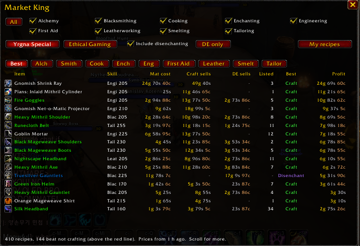

# Crafting Profits (was Market King)

The trading part of King Maker. Pick the professions you care about and
Crafting Profits tells you, for every item they can make, whether you're
better off:

- **selling the raw materials**,
- **crafting the item and selling it**, or
- **crafting it, disenchanting it and selling the enchanting materials**.

Prices come from King Maker's Scanner (Auction House > Prices).

Since King Maker 2.0 it has no window or minimap button of its own: it's the
**Crafting > Crafting Profits** page of the King Maker window. Your Market King
1.x settings, learned recipes and have/don't-have marks move in by themselves.

## Where things are

| What | Where |
|---|---|
| The ranked list | King Maker window, **Crafting > Crafting Profits** (`/mk` or `/km crafting`) |
| Open it from the minimap | Right-click the King Maker crown: **Crafting Profits** |
| Scanning | The Scanner's one **Scan**: the auction house title bar, the **Scan** button on the page, the crown's right-click menu (at the auction house), or `/mk scan` |
| Settings | King Maker **Settings > Market** |

## Use

1. Tick the professions you care about at the top of the page (Alchemy,
   Blacksmithing, Cooking, Enchanting, Engineering, First Aid, Leatherworking,
   Smelting, Tailoring; **All** ticks or unticks them all).
2. At the auction house, click **Scan** (the title bar, or the button on this
   page). When the game allows a full scan (once every 15 minutes) it prices
   every item on the auction house; otherwise it does a quick scan of Trade
   Goods plus every item the ticked professions make and use, and every
   disenchanting material. There is no picker any more: the ticks are the
   choice.
3. The page updates when the scan is done. Open it any time from the King
   Maker window, the crown's right-click menu or `/mk`.
4. **Best** has every ticked profession together; the other tabs have one
   profession each (short names when they're all ticked). Everything is
   sorted most profitable first.

Each row shows:

| Column | Yrgna Special (buying mats) | Ethical Gaming (farming mats) |
|---|---|---|
| Mat cost / Raw value | What the materials cost to buy | What your materials would sell for |
| Craft sells | What the crafted item(s) sell for, after the 5% auction cut | same |
| DE sells | Average disenchant value of the item(s), after the cut | same |
| Listed | How many of the crafted item are on the auction house right now | same |
| Best | CRAFT, DISENCHANT, or SKIP | CRAFT, DISENCHANT, or SELL RAW |
| Profit / Gain vs raw | The better sale minus the material cost | The better sale minus vendor reagents, minus what the raw materials would sell for |

**Include disenchanting** (on by default) decides whether disenchanting counts
as an option. **DE only** shows just the items that can be disenchanted, ranked
by what crafting and disenchanting them makes, for when you're only hunting
disenchant profits; **No procs** next to it values disenchants without the
rare shard and crystal procs.

The recipes button (right, under Scan) chooses which recipes you see;
click it to switch:

- **All recipes**: everything, with patterns you don't have greyed out.
- **My recipes**: trainer recipes plus the patterns you have.
- **Patterns I lack**: only patterns you don't have, to see which are worth
  getting.

Trainer recipes always count as yours. A pattern recipe (one taught by a
pattern, plans, schematic, formula, manual or recipe item) counts once you open
that profession's trade skill window and King Maker sees you know it. Right-click
any row to mark it as had or not had yourself, for example a pattern sitting in
your bank. Marks are kept per character; `/mk recipes reset` clears them.

**Listed** shows supply, not sales: lots listed means competition, very few
can mean nobody makes it, or nobody buys it. Check the item's listings before
crafting a stack.

The **red line** marks where crafting stops paying. Everything below it is
better left as raw materials.

**Yrgna Special** (buying mats) treats materials as something you buy, which is how you find
flips. **Ethical Gaming** (farming mats) treats them as already yours, so it compares crafting
with just selling what you gathered. Vendor reagents (thread, flux, vials) are
a cost either way.

Hover a row for the full breakdown: each material and its price, what the item
sells for, and what it disenchants into on average.

## Where the numbers come from

- **Recipes:** every WoW: Forever recipe that makes an item (2,269 of them, all
  nine professions), Forever's new ones and its changes to Classic's, from
  ForeverDB.net. When you open a trade skill window, King Maker checks it
  against that list: a recipe it doesn't know is added, and one Forever changed
  since (different reagents) uses what your window shows.
- **Patterns:** which of those recipes are taught by a pattern, plans, formula
  or recipe item (drops, vendors, quests, reputation, Merchant's Favor), and
  which item teaches each.
- **Disenchanting:** the Classic disenchant tables by quality and item level.
  The value is an average over many disenchants, not a guarantee for one.
- **Vendor reagents:** what you last paid at a vendor (noted whenever you open
  one), or an estimate until you've visited one.
- **Prices:** the Scanner's latest scan. Items not on the auction house show
  "-", and a recipe with an unpriced material shows "missing" until it's priced.

| Command | What it does |
|---|---|
| `/mk` | Open or close the Crafting Profits page |
| `/mk scan` | Scan (auction house open): prices the ticked professions |
| `/mk mode buy` / `farm` | Yrgna Special (bought) or Ethical Gaming (farmed) |
| `/mk recipes all` / `mine` / `missing` | Which recipes to show |
| `/mk recipes reset` | Clear your have/don't-have marks |
| `/mk button` | Points you at the King Maker crown (`/km button`) |

The same choices (Yrgna Special or Ethical Gaming, disenchanting, which
recipes) are also rows in **Settings > Market**, with a button to clear your
marks.

## Tests

`python tests/run.py market` from the `King_Maker` folder (`pip install lupa`).

## Credits

Recipe data from ForeverDB.net (https://foreverdb.net), GPL-3.0. `Data/Recipes.lua` and `Data/Patterns.lua` are
generated by `tools/build_recipes.py` in the workspace from ForeverDB's addon data (King Dashboard downloads it); run
it again after a Forever patch. King Maker is released under the GPL-3.0 (`LICENSE`).
