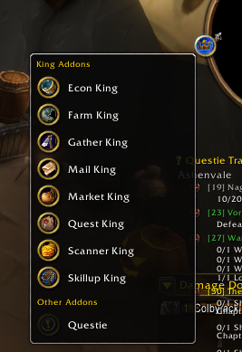

# Minimap buttons (was Minimap King)



Every other addon's minimap button in one menu. King Maker moves any addon's minimap button into a
drop-down that opens from the King Maker crown, so the edge of your minimap stays clear.

Since King Maker 2.0 the crown is King Maker's own: there's no second crown any more. The menu is a
quick action on that crown, and the list of which buttons go in is a section of King Maker's
Settings. Your Minimap King 1.x choices move in by themselves.

## Where things are

| What | Where |
|---|---|
| The menu | Right-click the King Maker crown: **Minimap buttons** (or `/mmk`) |
| Which buttons go in it | King Maker **Settings > Minimap buttons** (or `/mmk settings`) |

## The menu

- Each line is the addon's real button with its name next to it, so everything works as before:
  left-click, right-click, tooltips and menus.
- Clicking a name does the same as clicking its button, and the menu closes once you've picked one.
- **Shift-right-click** a name to leave that button on the minimap instead. `/mmk unignore` takes
  them all back in.
- Escape, or a click out in the world, closes the menu.
- Blizzard's own minimap buttons (tracking, calendar, mail and so on), map pins and the King Maker
  crown stay where they are.

Picks up any addon that uses LibDBIcon (Questie, DBM, Details and most others) and other buttons
sitting around the edge of the minimap. If it takes something it shouldn't, shift-right-click it or
untick it in Settings.

## Settings

| Setting | |
|---|---|
| Gather minimap buttons into the menu | Off puts every button back on the minimap |
| One check per addon button | Ticked: in the menu. Unticked: stays on the minimap |

## Commands

| Command | |
|---|---|
| `/mmk` or `/minimapking` | Open the menu |
| `/mmk settings` | Choose which buttons go in it |
| `/mmk release` | Put every button back on the minimap |
| `/mmk gather` | Take them into the menu again |
| `/mmk unignore` | Take back the buttons you left on the minimap |

`/mmk icon` now says the crown is King Maker's (`/km button` shows or hides it).

## For addon authors

```lua
MinimapKing.ShowMenu()   -- open the menu
MinimapKing.Gather()     -- look for new buttons now
MinimapKing.Release()    -- put every button back
MinimapKing.Shown()      -- the buttons in the menu, in order
```

## Tests

`python tests/run.py minimap` from `AddOns/King_Maker` (needs `pip install lupa`).
