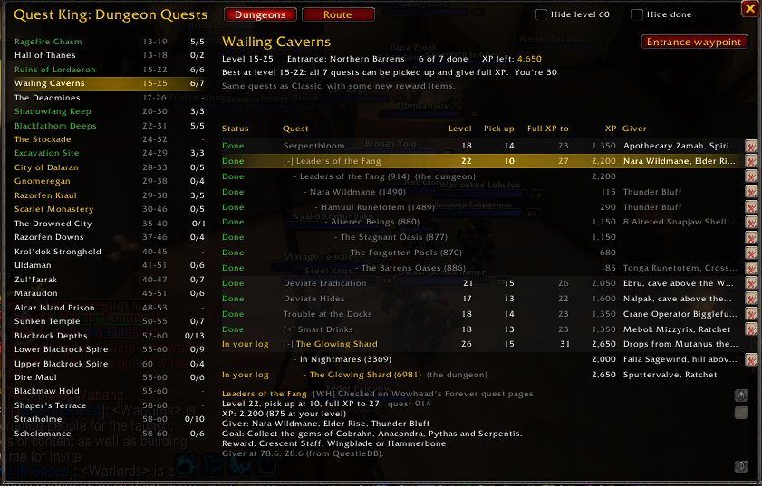

# Dungeon Quests and bag cleanup (was Quest King)

Two things for questing on WoW Forever, inside King Maker:

- **Dungeon quests.** Every dungeon quest a Horde character can take, level 13 to 60, with the chain
  behind each one: which you've done, which are in your log, which you can pick up now, the levels
  that matter, and a waypoint to each quest giver.
- **Bag cleanup.** Marks the quest items in your bags that no quest in your log needs, so you can
  see what's safe to delete when your bags are full.

Since King Maker 2.0 it has no window or minimap button of its own: the dungeon quests are the
**Characters > Dungeon Quests** page of the King Maker window. Your Quest King 1.x ticks and settings
move in by themselves.

## Where things are

| What | Where |
|---|---|
| Dungeon quests and the route | King Maker window, **Characters > Dungeon Quests** (`/qk dungeons` or `/km dungeons`) |
| Open it from the minimap | Right-click the King Maker crown: **Dungeon Quests** (its tooltip counts the quests ready and in your log) |
| Red X, tooltip line, Hide level 60, Hide done | King Maker **Settings > Quest** |
| Quest items you can delete | The red X on bag slots, the item tooltip, and `/qk` |

## Requirements

- **Needs:** Nothing. The dungeon log is built in, so every dungeon, quest and chain works without other addons.
- **Better with** (optional):
  - **[QuestieDB](https://github.com/Questie/QuestieDB/releases)** makes it exact: pickup levels, quest IDs, quest giver spawn points, dungeon entrances and **each quest's XP**. Without it pickup levels are estimates (marked ~), waypoints use the log's coordinates and the XP column shows ?.
  - **[Questie](https://github.com/Questie/Questie)** marks quests on your map and tracks objectives, alongside Quest King's chains.
  - **[TomTom](https://www.curseforge.com/wow/addons/tomtom)** gives waypoints an arrow. Without it Quest King uses the game's own map pin.

## Dungeon quests

Open it from the King Maker window (**Characters > Dungeon Quests**), the crown's quick actions, or
`/qk dungeons`. Two tabs at the top: **Dungeons** and **Route**.

**Left:** every dungeon in level order, with how many of its quests you've done. Gold means it's
right for your level now; green means you've done them all.

**Right:** the dungeon you picked.

- Its level range, where the entrance is (**Entrance waypoint** when QuestieDB knows it), and how
  many quests you've done.
- **Best at level X-Y:** the levels where you can pick up the most of its quests and every one still
  gives full XP (until 5 levels above the quest). Dungeon quests carry most of the dungeon XP on
  Forever, so this is when to run it.
- Each quest: your status, the quest's level, the level you can pick it up at, the last level it
  gives full XP, and who gives it. The map pin sets a waypoint to the giver (TomTom's arrow when you
  have TomTom, and the game's own map pin).
- XP for every quest and chain step at your level, and how much XP a dungeon's quests still have
  left (from QuestieDB). Grey XP means you've outlevelled it and get less. Quests give full XP up
  to 5 levels above them, then 80%, 60%, 40%, 20%, and 10% from 10 levels on.
- Chains sit right under their quest. The last step is on top and each earlier step is indented
  one more, so the step indented furthest is where you start: work your way up. Each step shows
  Done, In your log, or **Next >** for the one to do now, and has its own map pin.
- Click a quest for its goal, reward and warnings in the panel below. Click it again to fold or
  open its chain (done quests start folded).
- Right-click a quest, or any step, to tick it off yourself (for quests the game can't check).

| Status | |
|---|---|
| Done | You turned it in, or ticked it off |
| In your log | It, or a step of its chain, is in your quest log |
| Chain started | You've done part of its chain |
| Ready | You're high enough level to pick it up |
| Too low | Not yet |

Class quests show only for that class. **Hide level 60** and **Hide done** trim the list.

**Route:** the dungeons in level order with what to pick up, hub by hub, before each run, and the
chains to start early.

### With QuestieDB

Install **QuestieDB-Forever** (the same one Farm King uses) and Quest King also gets:

- the exact level you can pick each quest up at (without it, it's estimated as 6 below the quest
  level and shown with a ~),
- quest IDs the dungeon log doesn't have, found by name, so more quests are checked automatically,
- where each quest giver stands, for the waypoint,
- where each dungeon's entrance is.

### The data

From the Forever Horde Dungeon Log (beta patch 1.60.1, October 10, 2026): Wowhead's Forever
database, beta client data, Classic data and fan guides. Each quest says which. Krol'dok
Stronghold, Alcaz Island Prison, The Drowned City, Blackmaw Hold and Shaper's Terrace weren't in the
beta yet, so their quests are still unknown.

## Bag cleanup

- A small **red X** in the top-left corner of a bag slot means that quest item
  isn't needed by any quest in your log and no vendor buys it. It works with
  Bagnon and the default bags (one big bag or separate bags).
- Hovering the item adds a line to its tooltip saying why it's safe to delete.
- A quest item no quest needs but a vendor buys gets no X, just a tooltip line
  telling you to sell it.
- `/qk` lists every such item in chat.

## How it decides

Only quest items are looked at (the Quest item type, or items the game flags as
quest items). Trade goods a quest happens to want are never marked.

| Item | Marked? |
|---|---|
| Named in a quest's objectives in your log ("Wolf Fang: 3/8") | No |
| Named in a quest's description in your log (a letter to deliver) | No |
| A quest's usable item | No |
| Starts a quest you're on, or one you haven't done yet | No |
| Starts a quest you've already finished | **Yes** |
| None of the above (left over from a quest you turned in or dropped) | **Yes** |

If a header in your quest log is collapsed and hides quests, Quest King marks
nothing until you expand it, so it never marks something you still need.

A marked item could still matter for a quest you haven't picked up yet (the
next step of a chain). Quest King only knows your current log.

## Commands

| Command | What it does |
|---|---|
| `/qk dungeons` | Open or close the Dungeon Quests page |
| `/qk route` | The Route tab |
| `/qk` | List quest items you can delete |
| `/qk marks on` / `off` | Show or hide the red X on bag slots |
| `/qk tooltip on` / `off` | Show or hide the tooltip line |

`/qk button` now points you to the King Maker crown (`/km button`).

## For addon authors

`QuestKing` is the module itself, as in 1.x: `QuestKing.Status(bag, slot)`, `QuestKing.Unneeded()`,
`QuestKing.DUNGEONS`, `QuestKing.QuestState(dungeon, quest)` and the rest.

## Tests

`python tests/run.py quest` from `AddOns/King_Maker` runs the module against a stand-in for the
Forever client: modern bags, modern tooltips, no Classic-only globals or events (needs `pip install lupa`).
