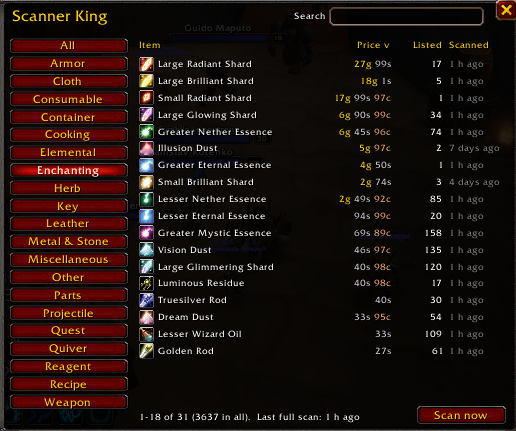

# Scanner (was Scanner King)

The auction house scanner of King Maker. It scans the auction house and keeps
the prices every other part of King Maker reads: Price History, Crafting
Profits, Skill-ups, Mob Farming, Gathering, the Sales Ledger and Inventory.

Since King Maker 2.0 it lives inside King Maker: no window or minimap button of
its own. Your Scanner King 1.x prices and settings move in by themselves.

## Where things are

| What | Where |
|---|---|
| The price list | King Maker window, **Auction House > Prices** (`/sk` or `/km prices`) |
| Scan | The auction house title bar, the Prices page, Crafting Profits, and the crown's right-click menu (at the auction house) |
| Tooltip and guild settings | King Maker **Settings > Scanner** |
| Price age | The status box under the King Maker sidebar, and the Home page |

## Scanning

King Maker has **one Scan**: a gold button in the auction house title bar (and
on the Prices page, on Crafting Profits, in the crown's right-click menu while
the auction house is open, and `/sk scan`). What a click does depends on what
the game allows right now, and the button says which one you'll get: **Full
scan**, or **Quick (full in 9m)** while the game's wait runs:

- **Full scan** (the Deep Scan) when the game lets King Maker download every
  auction at once, which it allows once every 15 minutes. It prices every item
  on the auction house and works out each item's **market price**: the average
  of the cheapest 15 to 30% of what's listed, so one silly listing doesn't
  decide it. It also keeps the lowest buyout, how many are listed, and in how
  many auctions. About a minute.
- **Quick scan** the rest of the time: every Trade Goods item, plus everything
  the rest of King Maker watches (Price History favorites, Gathering,
  cooldowns...), plus everything the professions ticked on **Crafting Profits**
  make and use. Lowest prices only. Chat says why it's a quick scan and how
  long until the next full one; the button counts down, turns back into **Full
  scan** when the wait is over, and chat tells you so if the auction house is
  open. The 15 minutes are shared by all your characters, so a full scan on an
  alt means a quick scan here for a while (chat names the alt).

There is no profession picker any more: the ticks on Crafting Profits are the
choice. The scan in progress shows on the button, and hovering it shows what
it's on. Keep the auction house open until the scan says it's done.

On the modern auction house a quick scan takes a handful of requests: it
browses the whole Trade Goods category a page at a time, then looks up the
other items in searches of 100, and only searches item by item if one of those
doesn't answer.

For power users, `/sk deep` forces a full scan with a small progress window
(while the full download is on cooldown it browses every category instead:
lowest prices only), `/sk material` forces a quick scan of Trade Goods and
watched items only, and `/sk market` a quick scan with the ticked professions.

## The Prices page

Everything Scanner has a price for, not just raw materials.

- Across the top: how many prices you have (and when the last quick scan ran),
  when the last full scan ran (amber when it's more than a day old), how many
  have a market price, and whether guild sharing is on.
- The left side groups items the way the auction house does: Metal & Stone,
  Herb, Cloth, Leather, Enchanting, Elemental, and so on. **All** shows
  everything. The mouse wheel scrolls the list when a full scan brings more.
- Type in **Search prices** to filter by name.
- Click a column header (Item, Market, Lowest, Listed, Scanned) to sort by it,
  and again to flip the order. Hover an item for its tooltip.
- **Scan** sits top right (the same one scan as the title bar).

## Tooltips

Every item tooltip (bags, bank, loot, links, the auction house) gets a
**King Maker** section, laid out like this:

| Row | What it shows |
|---|---|
| **King Maker** ... **AUCTION** / **VENDOR** / **DISENCHANT** | Which pays most for one (the auction house after its 5% cut, a vendor, or disenchanting it), and by how much |
| Auction house | The market price (or lowest buyout) and when it was scanned, and by which guildmate if it came from one |
| Lowest buyout, Listed | The cheapest listing, and how many are up in how many auctions |
| 30-day average, 7-day trend | From Price History |
| Vendor, Vendors sell | What a vendor pays you for one, and what you paid a vendor for one |
| Disenchant | On gear: what disenchanting one is worth on average, at today's prices, after the cut (shows even when nobody lists the item) |
| Materials to craft, You can craft it | On crafted gear, potions and bags (not on materials like leather or bars): what the materials for one cost at today's prices, then a line saying whether crafting one to sell makes money (green) or loses it (red; "Buying one is cheaper than crafting it" when the materials cost more than one sells for), and which of your characters can make it |
| Teaches, Known by, Can learn it, Skill too low | On patterns, plans, formulas and recipes: the recipe and its skill, and where each of your characters stands |
| Drops | The two mobs with the best drop chance (your kills and your guild's), with zone; QuestieDB fills in the rest |
| Used in | The professions with recipes that take it. Tick *Most valuable crafts it's used in* (Settings > Scanner, or `/sk tip crafts on`) to also list the 3 most valuable things to make from it; it's off by default to keep the tooltip short |
| You own | How many, what they're worth, and on which characters |

Every group has its own switch in **Settings > Scanner**: `/sk tooltip off` hides
the prices, `/sk sources off` hides Vendor, Drops and Used in, and
`/sk tip crafts|make|pattern|de off` hides the others. **Short tooltip**
(`/sk tip short on`) shows only the verdict, the price and how many you own
until you hold Shift. Your characters' skills and known recipes come from
opening their profession windows once.

| Command | What it does |
|---|---|
| `/sk` or `/sk show` | Open or close the Prices page |
| `/sk scan` | Scan (the auction house must be open): a full scan when the game allows one, else a quick scan |
| `/sk deep` | Force a full scan, with its progress window (browses every category while the full download is on cooldown) |
| `/sk material` | Force a quick scan of Trade Goods and watched items only |
| `/sk market` | Force a quick scan with the professions ticked on Crafting Profits |
| `/sk tooltip on` / `off` | Prices in item tooltips |
| `/sk sources on` / `off` | Vendor price, drops and recipes in item tooltips |
| `/sk tip crafts\|make\|pattern\|de\|short` `on` / `off` | Best crafts, craft cost, recipe items, disenchant value; short = details with Shift |
| `/sk status` | How many prices you have, when the last full and quick scans ran, when a full scan is ready, and the newest scan you hold |
| `/sk sync` | Send your prices to your guild now |
| `/sk sync on` / `off` | Turn guild price sharing on or off |
| `/sk sync loot on` / `off` | Ask the guild for prices of what you loot |
| `/sk sync pull` | Ask the guild for a newer scan than yours (done by itself at login) |
| `/sk sync full on` / `off` | Also pass on every item of full scans, not only Trade Goods |

`/sk button` now points you to the King Maker crown (`/km button`).

## Guild sharing

Everyone in your guild running King Maker shares prices. For each item the
newest price wins.

- **Trade Goods and the items other parts of King Maker watch are shared
  automatically.** After a scan your prices go to the guild right away.
- **Logging in catches you up.** King Maker remembers the newest scan you hold,
  yours or a guildmate's. When you log in it asks the guild who has a newer one;
  the guildmate online with the freshest scan answers (only one does) and sends
  you every price newer than yours in the background, including prices it got
  from someone else. Each price keeps the name of whoever scanned it. So a
  morning scan reaches people who log in at night, as long as anyone online has
  it. If your scan is the newest, guildmates tell you and it goes to the guild
  once. A chat line says what you got: *Synced 412 newer price(s) from Bob
  (Ann's scan, 25 min ago).*
- **Everything else is shared when someone asks.** Price History's **Ask
  guild** buttons ask for just those items. Guildmates holding a price from the
  last week answer (their own scan or one passed on to them, still under the
  scanner's name), and anyone who sees a price as fresh as theirs already sent
  stays quiet. Items you scanned yourself in the last hour aren't asked for.
- **What you loot is asked about by itself.** When something drops in a
  dungeon or while farming that you have no price for, or only one over 6
  hours old, King Maker asks the guild: once a session per item, half a
  minute of drops in one small message. Grey items, quest items and items that
  bind when picked up are skipped. The price lands in the tooltip and the Farm
  Tracker within seconds, as long as someone online has it. Turn it off in
  Settings > Scanner or with `/sk sync loot off`.
- **Share my full scans** (Settings > Scanner, off by default) passes on every
  item of a full scan too, after the Trade Goods. A whole auction house is about
  290 messages, so it trickles in over a few minutes.

Prices older than two days aren't passed on, so old prices don't keep circling
the guild. Prices are packed tightly: about 25 to a message, with market price
and number listed included. The game allows about one addon message a second,
so the Trade Goods (about 400) take around 20 seconds. Requests and answers
always go before a catch-up that's still sending. The **Prices** page's Guild
sharing tile shows the newest scan you hold and whose it is.

## For addon authors

The `ScannerKing` global is unchanged; see [API.md](API.md).
