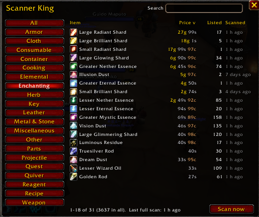

# Scanner (was Scanner King)

The auction house scanner of King Maker. It scans the auction house and keeps
the prices every other part of King Maker reads: Price History, Crafting
Profits, Skill-ups, Mob Farming, Gathering, the Sales Ledger and Inventory.

Since King Maker 2.0 it lives inside King Maker: no window or minimap button of
its own. Your Scanner King 1.x prices and settings move in by themselves.

## Where things are

| What | Where |
|---|---|
| The price list | King Maker window, **Auction House > Prices** (`/sk` or `/km prices`) |
| Material Scan, Market Scan, Deep Scan | The auction house title bar, the Prices page, and the crown's right-click menu |
| Tooltip and guild settings | King Maker **Settings > Scanner** |
| Price age | The status box under the King Maker sidebar, and the Home page |

## Scanning

The auction house title bar gets three gold buttons:

- **Material Scan** prices every Trade Goods item (ores, herbs, leather, cloth,
  enchanting materials and more), plus anything Gathering asks for. Or type
  `/sk scan`.
- **Market Scan** (shown when Crafting Profits is loaded) opens a small window
  with every profession ticked. Untick what you don't want and click **Scan**:
  it prices Trade Goods plus everything those professions make and use, then
  opens Crafting Profits on the results.
- **Deep Scan** prices every item on the auction house. It downloads every
  auction at once (the game allows that once every 15 minutes) and works out
  each item's **market price**: the average of the cheapest 15 to 30% of what's
  listed, so one silly listing doesn't decide it. It also keeps the lowest
  buyout, how many are listed and in how many auctions. Within 15 minutes of
  the last one it browses every category instead, which gives lowest prices
  only. The button opens a small window that says which of the two you'll get
  (and when the full one is ready again); click **Scan** and a progress bar
  follows it through downloading, reading every auction and loading item
  details, then shows how many items it priced. `/sk deep` opens it and starts
  straight away.

The scan in progress shows on its button, and hovering it shows what it's on.
Keep the auction house open until the scan says it's done.

On the modern auction house a Material Scan takes a handful of requests: it
browses the whole Trade Goods category a page at a time, then looks up the
items other modules asked for in one more search, and only searches item by
item if one of those doesn't answer.

## The Prices page

Everything Scanner has a price for, not just raw materials.

- Across the top: how many prices you have, when you last Deep Scanned (amber
  when it's more than a day old), how many have a market price, and whether
  guild sharing is on.
- The left side groups items the way the auction house does: Metal & Stone,
  Herb, Cloth, Leather, Enchanting, Elemental, and so on. **All** shows
  everything. The mouse wheel scrolls the list when a Deep Scan brings more.
- Type in **Search prices** to filter by name.
- Click a column header (Item, Market, Lowest, Listed, Scanned) to sort by it,
  and again to flip the order. Hover an item for its tooltip.
- **Material Scan**, **Deep Scan** and **Market Scan** sit top right.

## Tooltips

Every item tooltip (bags, bank, loot, links, the auction house) shows what
Scanner knows: market price, lowest buyout, how many are listed and when it
was scanned. Price History adds its averages and trend underneath.
`/sk tooltip off` (or the setting) turns it off.

| Command | What it does |
|---|---|
| `/sk` or `/sk show` | Open or close the Prices page |
| `/sk scan` | Material Scan (the auction house must be open) |
| `/sk deep` | Deep Scan: every item on the auction house (opens its window and starts) |
| `/sk market` | Market Scan: pick professions to price |
| `/sk tooltip on` / `off` | Prices in item tooltips |
| `/sk status` | How many prices you have and when you last scanned |
| `/sk sync` | Send your prices to your guild now |
| `/sk sync on` / `off` | Turn guild price sharing on or off |

`/sk button` now points you to the King Maker crown (`/km button`).

## Guild sharing

Everyone in your guild running King Maker (or Scanner King 1.x) shares
prices. For each item the newest price wins.

- **Trade Goods and Gathering's raw materials are shared automatically.**
  After a scan your prices go to the guild, and when you log in, guildmates who
  are online send you theirs. Only prices you scanned yourself in the last two
  days are sent, so old prices don't keep circling the guild.
- **Everything else is shared when someone asks.** Price History's **Ask
  guild** buttons ask for just those items. Guildmates who scanned them in the
  last week answer, and anyone who sees a price as fresh as theirs already sent
  stays quiet. Items you scanned yourself in the last hour aren't asked for.

Prices are packed tightly: about 25 to a message, with market price and number
listed included. The game allows about one addon message a second, so sharing
700 Trade Goods takes about 25 seconds. A whole Deep Scan of 3,000 items would
take about 2 minutes after every scan and again for everyone who logs in,
which is why it isn't sent unasked.

## For addon authors

The `ScannerKing` global is unchanged; see [API.md](API.md).
