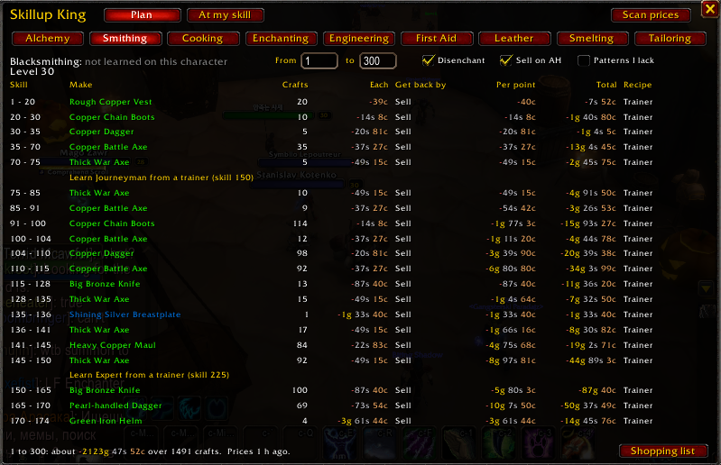

# Skill-ups (was Skillup King)



The cheapest way to level a profession on WoW Forever, inside King Maker.

It knows every WoW: Forever recipe (from ForeverDB.net) and the skill levels where each one turns orange, yellow,
green and grey. It prices the materials and what you make with the Scanner's auction house scans. From your
skill (and your level), it works out what to craft at every point to the top, for the least gold. A
plan can even make money when what you craft sells or disenchants for more than its materials.

Since King Maker 2.0 it has no window or minimap button of its own: it's the **Crafting > Skill-ups**
page of the King Maker window. Your Skillup King 1.x skills, known recipes and settings move in by
themselves.

## Where things are

| What | Where |
|---|---|
| The plan and At my skill | King Maker window, **Crafting > Skill-ups** (`/suk` or `/km skillups`) |
| Open it from the minimap | Right-click the King Maker crown: **Skill-ups** |
| Your profession skills | The crown's tooltip (hover it) |
| Settings | King Maker **Settings > Skillup** |

## Use

1. **Get prices.** At the auction house, click **Scan prices** (top right of the page; it's dimmed
   away from the auction house). It scans everything the profession uses and makes, its patterns,
   and the disenchanting materials. A Deep Scan covers everything too.
2. **Pick a profession** from the row of buttons. Your skill and level show under it. Open the
   profession's window once (press its spellbook button) so King Maker learns which pattern recipes
   you know.
3. **Read the plan.** For each stretch of skill it shows:

   | Column | |
   |---|---|
   | Make | The recipe to craft |
   | Crafts | How many, on average (yellow and green don't always give a point) |
   | Each | One craft: materials minus what you get back. Below zero, it makes money |
   | Get back by | Selling it on the auction house, disenchanting it, or a vendor: whichever pays most |
   | Per point / Total | What the skill points cost |
   | Recipe | Trainer, Known, or the pattern you'd need and its price |

   Trainer visits (Journeyman at 75, Expert at 150, Artisan at 225) get their own lines, in red when
   you're not high enough level yet. **Shopping list** (bottom right) shows every material the plan
   needs when you hover it; click it to print the list in chat.
4. **At my skill** (next to **Plan** at the top) lists every recipe you can make right now, cheapest skill point first, with its
   color and its chance of a point.

Change **From** and **To** to plan any stretch, like your next 25 points or the way to 300. Empty
**From** goes back to your skill; Escape puts the box back as it was.

### What counts

- **Disenchant:** count disenchanting what you make and selling the materials. Turn it off if no one
  can disenchant for you.
- **Sell on AH:** count selling what you make. Turn it off when the market is flooded; only a vendor
  (and disenchanting) is counted then.
- **Patterns I lack:** also use recipes from patterns you don't have yet. Their price shows so you can
  see if buying one pays off.

The same three are rows in **Settings > Skillup**, with which view the page opens on.

## The math

- Orange gives a point every time. Yellow and green give one with a chance of
  (grey − skill) / (grey − yellow), which falls as you near grey. Grey gives nothing.
- Materials cost the cheaper of the auction house and a vendor.
- Cost per point = (materials − what you get back) / chance.
- At every skill, the plan makes whatever is cheapest per point. Points don't depend on each other,
  so that's the cheapest plan on average.
- Missing prices are never counted as free. Points with nothing priced show as a gap: scan, or allow
  patterns you lack.

## Commands

| Command | |
|---|---|
| `/suk` | Open or close the Skill-ups page |
| `/suk <profession>` | Open it on a profession (`/suk first aid`, `/suk smelting`) |
| `/suk button` | Points you at the King Maker crown (`/km button`) |

## For addon authors

```lua
SkillupKing.Plan(professionID, fromSkill, toSkill)
-- returns steps { { from, to, r = recipe, crafts, cost } or { note } ... }, total cost in copper
```

## Data

Recipes, skill colors and patterns: data from ForeverDB.net (https://foreverdb.net, GPL-3.0), every
WoW: Forever recipe (2,449, enchants included) with Forever's own skill ranges. Generated by
`tools/build_recipes.py`. Disenchanting tables are the same as Crafting Profits' (each module keeps its
own copy).

## Tests

`python tests/run.py skillup` from the `King_Maker` folder (`pip install lupa`).
