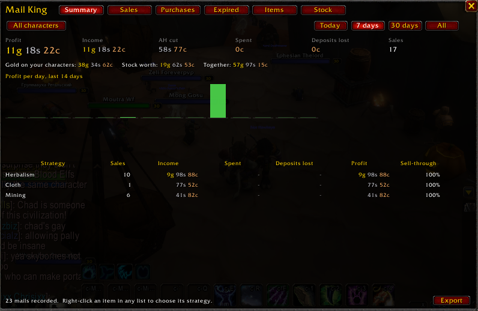

# Mail King



The money side of the King suite. Every auction house mail you open goes into a ledger, so you can
see what you actually made, where it came from, and which of your farms and strategies pay off.

- **Gather King** finds the nodes, **Farm King** finds the mobs, **Scanner King** prices it all.
- **Mail King** tells you what it turned into, who's buying it, and what isn't selling.
- **Inventory King** tells you what you're still holding and your net worth.

## Requirements

- **Needs:** Nothing. Mail King reads your mail on its own.
- **Better with** (optional):
  - **Scanner King** adds today's market price on the Items and Not selling pages.
  - **Farm King** puts items mobs drop under the Mob drops strategy.
  - **Inventory King** adds your net worth to the Summary, and how many you still hold to Not selling.

## What it records

Open your mailbox and every auction house mail in it is recorded, once:

| Mail | What's kept |
|---|---|
| Auction successful | Price, the auction house cut, the buyer, and when it sold |
| Auction won | What you paid and the seller |
| Auction expired / cancelled | The deposit you lost |

- **Opening the mailbox again changes nothing.** You don't have to take the gold out either: a mail
  is remembered and only ever counted once.
- **Sales are dated when they sold, not when you read the mail.** Auction mail lasts 30 days, so the
  time left on it gives the date.
- **Deposits and prices.** When you post an auction, Mail King notes its deposit and your price, so
  an expired auction shows what it cost you and what you were asking.
- **Buyers.** Every sale mail names the buyer, so Mail King knows who buys from you, how often and
  what.
- **Characters.** Each character's mail is kept separately. Look at all of them together, or just
  the one you're on.

## The window

Open it with `/mlk` or the minimap button. Pick the period (**Today**, **7 days**, **30 days** or
**All**) and whose mail you're looking at (all characters, or this one).

- **Summary.** Profit, income, the auction house cut, what you spent and deposits lost, your best
  buyer, and your net worth when Inventory King is installed. Below that, profit per day for the
  last two weeks, and every strategy ranked by profit with its sell-through. Click a strategy to see
  its items.
- **Sales, Purchases, Expired.** Every one, newest first.
- **Items.** Every item you've traded: units sold, average price, income, spent, sell-through, and
  Scanner King's market price today, so you can see whether you're selling under the market. Click
  a column to sort.
- **Not selling.** Every item that came back expired or cancelled, worst first (most deposits
  lost): how many sold and came back, sell-through, deposits lost, what you asked against today's
  market price, when it last sold, and why it might be stuck:
  - **over market**: you asked 10% or more over today's market price (in red, with how much),
  - **never sold**: none sold in this period,
  - **slow**: under half of them sold.

  Hover an item for the numbers and a suggestion. With Inventory King, it shows how many you still
  have too.
- **Buyers.** Everyone who bought from you: how many of your auctions (one mail each), units, what
  they paid, their average sale, their share of your sales, how many different items and their
  favourite. Your regulars (3 or more sales) are in gold. Hover one for everything they've bought;
  click one for just their sales. The **Buyers** button switches to **Sellers**: the people you buy
  from. Hover a sale on the Sales page to see how many times that buyer has bought from you.

Stock (what you hold on every character) and your gold moved to **Inventory King** in 1.2. It brings
over everything Mail King 1.1 knew the first time it loads.

**Profit = income (after the cut) − what you spent − deposits lost.**

## Strategies

Every item counts toward a strategy, which is how the ledger answers "which of my farms is working?"
An item gets one automatically, in this order:

1. **Your choice.** Right-click any item, in any list, to pick a strategy or make a new one, such as
   "Arathi wool farm" or "Strath runs".
2. **Flips.** You bought it on the auction house within 30 days before selling it. What you paid and
   what it sold for land on the same line, so its profit is your margin. Something you bought and
   haven't sold counts under **Purchases**.
3. **The kind of material.** Mining, Herbalism, Skinning, Cloth, Enchanting, Cooking, Elemental.
4. **Mob drops.** Farm King knows mobs drop it, from your loot, your guild's, or QuestieDB.
5. **Everything else.** Gear, Consumables, Recipes, Other.

Your choices apply to past sales too, so you can sort old history into strategies whenever you like.

## Export

**Export** (or `/mlk export`) gives the whole ledger as comma-separated text. Press Ctrl+A, then
Ctrl+C, and paste it into a spreadsheet.

## Commands

| Command | |
|---|---|
| `/mlk` | Open Mail King |
| `/mlk status` | What's been recorded |
| `/mlk export` | The ledger as text for a spreadsheet |
| `/mlk button on` / `off` | The minimap button |
| `/mlk reset yes` | Clear the whole ledger |

## Works with

Mail King works on its own. Each of these adds to it if you have it:

- **Scanner King.** Today's market price on the Items and Not selling pages, and its money formatting.
- **Farm King.** Items mobs drop go under Mob drops.
- **Inventory King.** Your net worth on the Summary, and how many you still hold on Not selling.
  Inventory King's Items page also sorts your items into Mail King's strategies.

## For addon authors

```lua
MailKing.GetEntries()      -- copies of every ledger line: { t, k = "sale"|"buy"|"expired"|"cancelled",
                           --   item, name, n, g = price, cut, dep, each = asking price (expired), who, c = "Name-Realm" }
MailKing.Summary(since)    -- { income, spent, lost, profit, sales } since a server time (0 = all)
MailKing.StrategyOf(itemID)
MailKing.Buyers(since)     -- { { who, mails, units, gold, last } }, most sales first
MailKing.Stock(itemID)     -- how many you hold (asks Inventory King; 0 without it)
```

## Limits

- Only mail you open is recorded. Mail that expires unread, or that you read before installing Mail
  King, isn't.
- A deposit, and what you asked, are known only for auctions posted while Mail King was running.
- A sale without an invoice (rare) has no buyer's name, so it isn't on the Buyers page.
- A sale mail names the item but doesn't carry its ID. Mail King learns IDs as you post, buy and get
  items back, and looks up the rest by name.

## Tests

```
pip install lupa
python3 tests/run.py .
```
