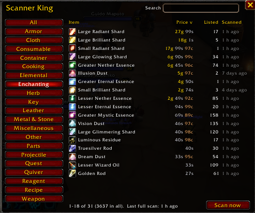

# Scanner King

The auction house scanner for the King suite on WoW Forever:

- **Gather King** marks gathering nodes and tracks what you farm.
- **Scanner King** (this addon) scans the auction house and keeps the prices.
- **Market King** uses those prices for trading.
- **Econ King** keeps the long-term history and graphs it.

Scanner King works by itself, but Gather King and Market King read their
prices from it, so install it next to them.

## Requirements

- **Needs:** Nothing. Scanner King works on its own.
- **Works with:**
  - Market King, Econ King, Farm King, Gather King, Mail King and Skillup King all read their prices from it.
  - Guildmates running Scanner King share prices with you automatically.

## Install

The easiest way: download [King Maker](https://github.com/artificial-bones/King_Maker), which has every King addon in one zip. To install just this one:

1. Download this repo (Code, then Download ZIP) and unzip it.
2. Rename the folder from `Scanner_King-main` to `Scanner_King`. The folder
   name has to match the `.toc` file name.
3. Put it in `_classic_beta_\Interface\AddOns\` next to `gather_king`.

## Use

The auction house title bar gets three buttons:

- **Material Scan** prices every Trade Goods item (ores, herbs, leather, cloth,
  enchanting materials and more), plus anything Gather King asks for. Or type
  `/sk scan`.
- **Market Scan** (shown when Market King is installed) opens a small window
  with every profession ticked. Untick what you don't want and click **Scan**:
  it prices Trade Goods plus everything those professions make and use, then
  opens Market King on the results.

- **Deep Scan** prices every item on the auction house. It downloads every
  auction at once (the game allows that once every 15 minutes) and works out
  each item's **market price**: the average of the cheapest 15 to 30% of what's
  listed, so one silly listing doesn't decide it. It also keeps the lowest
  buyout, how many are listed and in how many auctions. Within 15 minutes of
  the last one it browses every category instead, which gives lowest prices
  only. The button opens a small window that says which of the two you'll get
  (and when the full one is ready again); click **Scan** and a progress bar
  follows it through downloading, reading every auction and loading item
  details, then shows how many items it priced. `/sk deep` opens it and starts
  straight away.

The scan in progress shows on its button, and hovering it shows what it's on.

On the modern auction house a scan takes a handful of requests:

1. It browses the whole **Trade Goods** category. The auction house sends back
   every item's lowest price and how many are listed, a page at a time.
2. Items other addons asked for that aren't Trade Goods (Forever's herb seeds,
   for example) are looked up together in one more search.
3. Only if one of those searches doesn't answer does it fall back to searching
   item by item. That way is slow because of Blizzard's search limit.

Keep the auction house open until the scan says it's done.

## Tooltips

Every item tooltip (bags, bank, loot, links, the auction house) shows what
Scanner King knows: market price, lowest buyout, how many are listed and when
it was scanned. Econ King adds its averages and trend underneath.
`/sk tooltip off` turns it off.

## Price list

Click the coin button on your minimap (or type `/sk`) to open the price list.
It shows everything Scanner King has a price for, not just raw materials: bars,
leather, bolts of cloth, potions' ingredients, everything in Trade Goods.

- The left side groups items the way the auction house does: Metal & Stone,
  Herb, Cloth, Leather, Enchanting, Elemental, and so on. **All** shows everything.
- Type in **Search** to filter by name.
- Click a column header (Item, Price, Listed, Scanned) to sort by it, and
  again to flip the order.
- Hover an item for its tooltip. Scroll with the mouse wheel.
- **Scan now** at the bottom starts a scan when you're at the auction house.

Right-click the minimap button to scan, and drag it to move it around the minimap.

| Command | What it does |
|---|---|
| `/sk` or `/sk show` | Open or close the price list |
| `/sk scan` | Scan (the auction house must be open) |
| `/sk deep` | Deep Scan: every item on the auction house (opens its window and starts) |
| `/sk tooltip on` / `off` | Prices in item tooltips |
| `/sk button on` / `off` | Show or hide the minimap button |
| `/sk status` | How many prices you have and when you last scanned |
| `/sk sync` | Send your prices to your guild now |
| `/sk sync on` / `off` | Turn guild price sharing on or off |

## Guild sharing

Everyone in your guild running Scanner King shares prices. For each item the
newest price wins.

- **Trade Goods and Gather King's raw materials are shared automatically.**
  After a scan your prices go to the guild, and when you log in, guildmates who
  are online send you theirs. Only prices you scanned yourself in the last two
  days are sent, so old prices don't keep circling the guild.
- **Everything else is shared when someone asks.** Econ King's **Ask guild**
  buttons (on every tab and every item page) ask for just those items.
  Guildmates who scanned them in the last week answer, and anyone who sees a
  price as fresh as theirs already sent stays quiet. Items you scanned yourself
  in the last hour aren't asked for.

Prices are packed tightly: about 25 to a message, with market price and number
listed included. The game allows about one addon message a second, so sharing
700 Trade Goods takes about 25 seconds. A whole Deep Scan of 3,000 items would
take about 2 minutes after every scan and again for everyone who logs in,
which is why it isn't sent unasked.

## For addon authors

See [API.md](API.md) for how Gather King and Market King talk to Scanner King.
