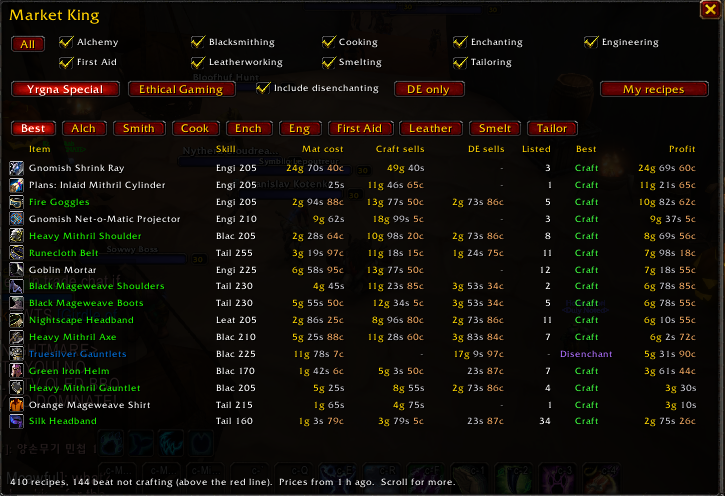
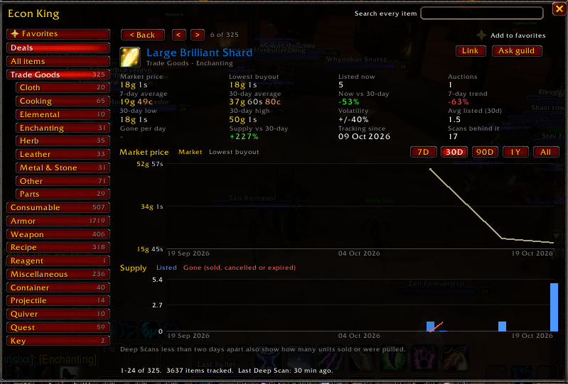
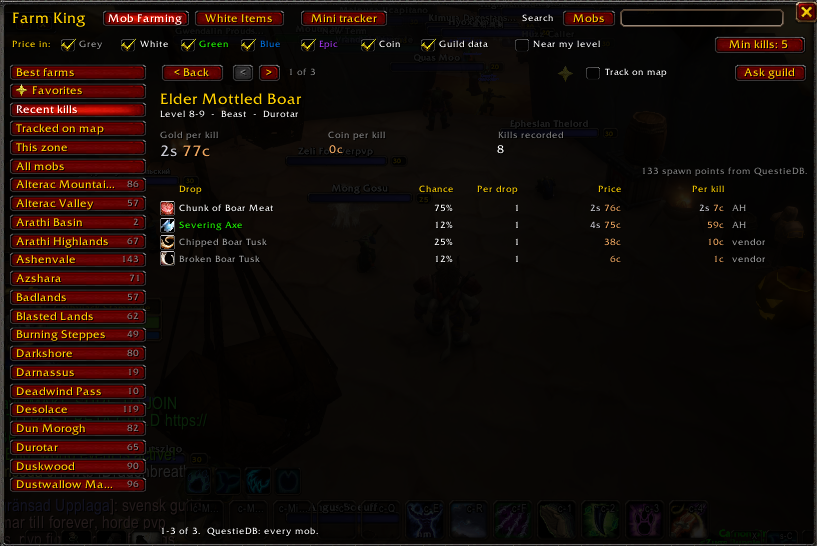
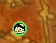
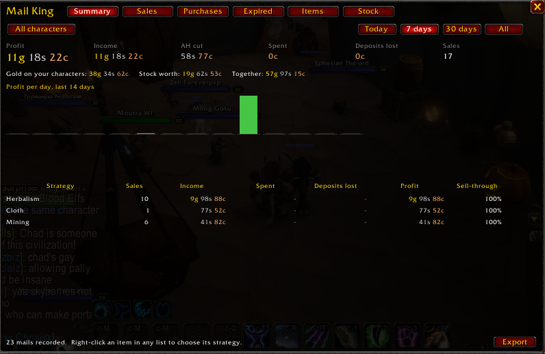
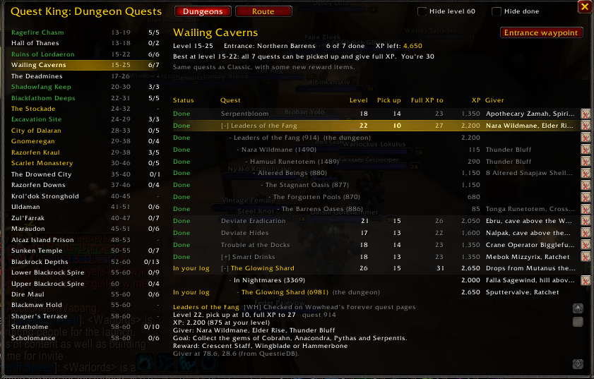
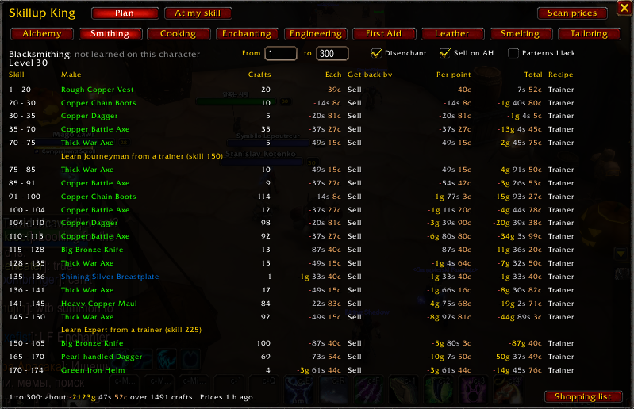
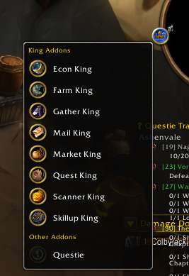

# King Maker

Every King addon in one download. The King addons are a suite of addons for **World of Warcraft: Forever**: price scanning, price history, trading, farming, gathering,
gold tracking, dungeon quests and profession leveling, all sharing one set of auction house prices.

**[Download the latest release](https://github.com/artificial-bones/King_Maker/releases/latest)** (`King_Maker.zip`).

## Install

1. Download `King_Maker.zip` from the [latest release](https://github.com/artificial-bones/King_Maker/releases/latest).
2. Unzip it. You get a folder for each addon (`Scanner_King`, `Market_King`, and so on).
3. Copy all of those folders into your AddOns folder. On the Forever client it is
   `World of Warcraft\_classic_beta_\Interface\AddOns\`
   (if the client folder is named differently, use the one that holds your Forever client).
4. Restart the game, or type `/reload` if you're already in. Check the AddOns list on the character
   screen that they're all turned on.

To update, download the new release and copy the folders over the old ones (say yes to replace).
Your settings and data are kept: they live in `WTF`, not in the addon folders.

You don't have to install everything. Scanner King is the one the others lean on, so keep it; the
rest are pick and choose.

### For the best experience, also install Questie and QuestieDB

[Questie](https://github.com/Questie/Questie) and its database,
[QuestieDB](https://github.com/Questie/QuestieDB/releases), aren't part of King Maker but make it
much better. Install both the same way (each is its own folder in AddOns):

- **Quest King** reads exact pickup levels, quest IDs, quest giver locations, dungeon entrances
  and each quest's XP from QuestieDB, so its waypoints, levels and XP are exact instead of
  estimated or missing.
- **Farm King** gets every mob in the game from QuestieDB, with levels, zones, spawn points and
  drops, instead of only the mobs you've seen yourself.
- **Questie** itself marks quests on your map and tracks objectives, which pairs well with Quest
  King's dungeon chains.

[TomTom](https://www.curseforge.com/wow/addons/tomtom) is optional too: Quest King uses its arrow
for waypoints when it's installed.

## The addons

Which addons need or use which, at a glance:

| Addon | Needs | Better with |
|---|---|---|
| Scanner King | - | - |
| Market King | Scanner King | - |
| Econ King | Scanner King | - |
| Farm King | Scanner King | Questie, QuestieDB |
| Gather King | - | Scanner King |
| Mail King | - | Scanner King, Farm King |
| Quest King | - | Questie, QuestieDB, TomTom |
| Skillup King | Scanner King | - |
| Minimap King | - | - |

### Scanner King: auction house prices

The price engine of the suite. It scans the auction house and keeps the prices that most of the other
King addon reads.

- **Three scans**, from buttons on the auction house title bar:
  - **Material Scan** prices every Trade Goods item (ore, herbs, leather, cloth, enchanting materials and more) plus anything the other Kings ask for.
  - **Market Scan** (with Market King) prices your chosen professions: everything they make and use.
  - **Deep Scan** prices every item on the auction house. It works out a **market price** from the cheapest 15 to 30% of listings, so one silly listing doesn't decide it, and keeps the lowest buyout and how many are listed.
- **Prices in every item tooltip**: market price, lowest buyout, how many are listed and when it was scanned.
- **Price list window**, grouped like the auction house (Metal & Stone, Herb, Enchanting...), with search and sortable columns.
- **Guild sharing**: Trade Goods prices go to guildmates running Scanner King after every scan, and anything else is shared when someone asks.

**Requirements**

- **Needs:** Nothing. Scanner King works on its own.
- **Works with:**
  - Market King, Econ King, Farm King, Gather King, Mail King and Skillup King all read their prices from it.
  - Guildmates running Scanner King share prices with you automatically.

Open it with `/sk` or its minimap button. [Full guide](https://github.com/artificial-bones/King_Maker/tree/main/AddOns/Scanner_King#readme)

### Market King: the most profitable crafts

Pick your professions and Market King tells you, for every item they make, whether you're better
off selling the raw materials, crafting and selling, or crafting and disenchanting.

- **Every Classic recipe** (over 1,100) for Alchemy, Blacksmithing, Cooking, Enchanting, Engineering, First Aid, Leatherworking, Smelting and Tailoring, ranked most profitable first.
- **Mat cost, craft sells, DE sells, listed, best choice and profit** for each one, after the 5% auction cut.
- **Two ways to count materials**: *Yrgna Special* treats them as bought (finds flips), *Ethical Gaming* treats them as farmed (compares crafting with selling what you gathered).
- **Disenchanting**: include it, or **DE only** to hunt disenchant profits.
- **Your recipes**: show all, only the ones you know, or the patterns you lack and whether they're worth buying.
- A **red line** where crafting stops paying, and a hover breakdown of every material and price.

**Requirements**

- **Needs:** **Scanner King**, for every price it uses. Market King won't load without it.
- **Works with:**
  - Scanner King's **Market Scan** button prices everything your professions make and use, then opens Market King.

Open it with `/mk` or its minimap button. [Full guide](https://github.com/artificial-bones/King_Maker/tree/main/AddOns/Market_King#readme)

### Econ King: long-term price history

The long-term memory of the auction house. Econ King keeps every scan Scanner King makes, so you
can see how any item's price and supply move over days, weeks and months.

- **Every item, every category**, with market price, today against its 30-day average, the 7-day trend, units listed and supply against normal.
- **Item pages** with 7- and 30-day averages, 30-day low and high, volatility, how many units leave the auction house per day, and **graphs of price and supply** over 7 days, 30 days, 90 days, a year or everything.
- **Deals**: items at least 20% under their 30-day average.
- **Favorites**, kept forever at one point a day, and searching across every item.
- **Ask guild** fills the gaps between your scans with guildmates' prices.
- Its averages and trend appear in item tooltips under Scanner King's prices.

**Requirements**

- **Needs:** **Scanner King** 1.5 or newer. Econ King records every scan it makes and won't load without it.
- **Works with:**
  - Guildmates running Scanner King answer **Ask guild**, filling the gaps between your own scans.

Open it with `/ek` or its minimap button. [Full guide](https://github.com/artificial-bones/King_Maker/tree/main/AddOns/Econ_King#readme)

### Farm King: which mobs are worth farming

Ranks mobs by the average gold a kill is worth: the coin they drop plus each drop's chance times
what it sells for, priced by Scanner King.

- **Drop rates from real kills**: every loot window you open is recorded, so the numbers come from what actually drops on Forever.
- **Best farms**, favorites, recent kills, this zone, and every zone in the game.
- **Mob pages** with gold per kill, coin per kill, kills recorded, and every drop's chance, price and value per kill.
- **Price filters** by quality, coin and guild data, a **near my level** filter, and a minimum number of kills.
- **Track on map** puts a mob's spawn points on your world map (from QuestieDB).
- **White Items**: the white-quality items worth farming, scored by price and how many spawn points drop them.
- **Mini tracker**: a small box that tallies your kills, drops and coin, with an optional timer for gold per hour, and **Ask guild** to pool drop data with guildmates.

**Requirements**

- **Needs:** **Scanner King**, which prices every drop. Farm King won't load without it.
- **Better with** (optional):
  - **[QuestieDB](https://github.com/Questie/QuestieDB/releases)** adds every mob in the game, with levels, zones, spawn points and what they drop, plus **Track on map**. Without it Farm King only knows the mobs you've seen yourself.
  - **[Questie](https://github.com/Questie/Questie)** itself isn't read by Farm King, but it's the addon QuestieDB is made for, and the two are best installed together.
- **Works with:**
  - Mail King files the items your mobs drop under its Mob drops strategy.
  - Guildmates running Farm King share their drop data when you **Ask guild**.

Open it with `/fk` or its minimap button. [Full guide](https://github.com/artificial-bones/King_Maker/tree/main/AddOns/Farm_King#readme)

### Gather King: mark gathering spots

Marks mining, herb, fishing and treasure spots on your world map and minimap, and tracks what your
gathering is worth.

- **Auto-tags nodes when you harvest them**, or mark one by hand: `/gt mine thorium` at a node.
- **Markers on the world map and minimap**, with size, opacity and per-type show/hide, and filters like `/gt only thorium, mithril`.
- **Loot stats per node** and "worth about X per harvest" from Scanner King's prices.
- **Farming ledger** with an optional timer for gold per hour.
- **Profiles** for different routes, and **guild sync** and share codes for friends.
- Works with **Leatrix Maps**: markers and coordinates line up with it.

**Requirements**

- **Needs:** Nothing. Gather King marks and tracks nodes on its own.
- **Better with** (optional):
  - **Scanner King** prices what you gather: worth per harvest on each marker and gold in the farming ledger. Without it prices only come from Auctionator, if you have it.
- **Works with:**
  - Works with Leatrix Maps: the markers and coordinates line up with it.
  - Markers are shared with guildmates running Gather King.

Open it with `/gt` or its minimap button. [Full guide](https://github.com/artificial-bones/King_Maker/tree/main/AddOns/gather_king#readme)

### Mail King: your auction house ledger

Reads your auction house mail into a ledger, so you can see what you actually made and where it
came from.

- **Every sale, purchase, expired and cancelled auction**, recorded once and dated when it happened, not when you read the mail.
- **Summary**: profit, income, the auction house cut, spent and deposits lost, for today, 7 days, 30 days or all time, with a profit-per-day chart.
- **Strategies** (Herbalism, Mining, Cloth, Mob drops...) so you see which of your farms pay off, with sell-through for each.
- **Items page**: units sold, average price, income and sell-through per item.
- **Stock**: everything you hold on every character (bags, bank, warband bank, mail and your auctions) and what it's worth.
- **Gold across all your characters**, and **Export** to a spreadsheet.

**Requirements**

- **Needs:** Nothing. Mail King reads your mail on its own.
- **Better with** (optional):
  - **Scanner King** adds today's market price on the Items page and what your stock is worth.
  - **Farm King** puts items mobs drop under the Mob drops strategy.

Open it with `/mlk` or its minimap button. [Full guide](https://github.com/artificial-bones/King_Maker/tree/main/AddOns/Mail_King#readme)

### Quest King: dungeon quests

Every Horde dungeon quest from level 13 to 60, with what you've done, what's next and where to go.

- **Every dungeon** in level order, with its level range, how many of its quests you've done, and its entrance.
- **Chains laid out inline**: each chain sits under its quest, the first step indented deepest, the step to do now marked **Next**, and a map pin on every line.
- **The levels that matter**: quest level, the level you can pick it up at, and the last level it gives full XP, plus the best levels to run each dungeon.
- **XP for every quest and step at your level**, and the XP each dungeon still has left.
- **Waypoints** to every quest giver and dungeon entrance, with TomTom's arrow if you have it.
- **The route**: the dungeons in level order with what to pick up in each city before you go.
- **Bag cleanup**: marks quest items in your bags that no quest in your log needs.

**Requirements**

- **Needs:** Nothing. The dungeon log is built in, so every dungeon, quest and chain works without other addons.
- **Better with** (optional):
  - **[QuestieDB](https://github.com/Questie/QuestieDB/releases)** makes it exact: pickup levels, quest IDs, quest giver spawn points, dungeon entrances and **each quest's XP**. Without it pickup levels are estimates (marked ~), waypoints use the log's coordinates and the XP column shows ?.
  - **[Questie](https://github.com/Questie/Questie)** marks quests on your map and tracks objectives, alongside Quest King's chains.
  - **[TomTom](https://www.curseforge.com/wow/addons/tomtom)** gives waypoints an arrow. Without it Quest King uses the game's own map pin.

Open it with `/qk` or its minimap button. [Full guide](https://github.com/artificial-bones/King_Maker/tree/main/AddOns/Quest_King#readme)

### Skillup King: level professions for the least gold

Works out the cheapest way to level a profession: what to craft at every skill point, at today's
auction house prices.

- **Every Classic recipe** and the skill where it turns orange, yellow, green and grey, with the chance of a skill-up at each point.
- **A plan from your skill to the top**: what to make, how many, the cost per craft and per point, and the total.
- **Counts what you get back** by selling on the auction house, disenchanting or vendoring, so some steps even make money.
- **Trainer reminders** at each rank, with the character level each one needs.
- **Patterns I lack**: include recipes you don't have yet, with the pattern's price.
- **Shopping list** of every material for the plan.

**Requirements**

- **Needs:** **Scanner King**, for material and crafted item prices. Skillup King won't load without it.
- **Works with:**
  - Uses the same disenchant tables as Market King to count what disenchanting gives back.

Open it with `/suk` or its minimap button. [Full guide](https://github.com/artificial-bones/King_Maker/tree/main/AddOns/Skillup_King#readme)

### Minimap King: one minimap button for all of them

Puts every addon's minimap button into one crown with a drop-down, so your minimap stays clean.

- **King Addons first**, then every other addon under **Other Addons**.
- **Each button still works exactly as before**: clicks, right-clicks, tooltips and menus. The menu closes once you pick one.
- **Settings** (right-click the crown) with a checkbox per addon: untick one to keep it on the minimap.
- **Pick your crown** with `/mmk icon`, and drag it anywhere around the minimap.

**Requirements**

- **Needs:** Nothing.
- **Works with:**
  - Gathers every King addon's button, and any addon that uses LibDBIcon (Questie, DBM, Details and most others), plus other buttons around the minimap's edge.

Open it with `/mmk` or its minimap button. [Full guide](https://github.com/artificial-bones/King_Maker/tree/main/AddOns/Minimap_King#readme)

## Credits

Thank you to the [Questie](https://github.com/Questie/Questie) team for Questie and
[QuestieDB](https://github.com/Questie/QuestieDB). Their quest, NPC and item database is what lets
Quest King and Farm King know every quest, mob, spawn point and quest reward in the game. King
Maker only reads that data; it doesn't include or change any of it, so install Questie and QuestieDB
from their own pages and support their authors.

Thanks also to the author of [TomTom](https://www.curseforge.com/wow/addons/tomtom), whose arrow
Quest King uses for waypoints.

## For maintainers

Each addon lives in `AddOns/<folder>`. To publish a release, run the **Release** workflow from the
Actions tab (or push a tag like `v1.0.0`): it zips the `AddOns` folders into `King_Maker.zip` and
attaches it to a new release. `./build.sh` makes the same zip locally.
